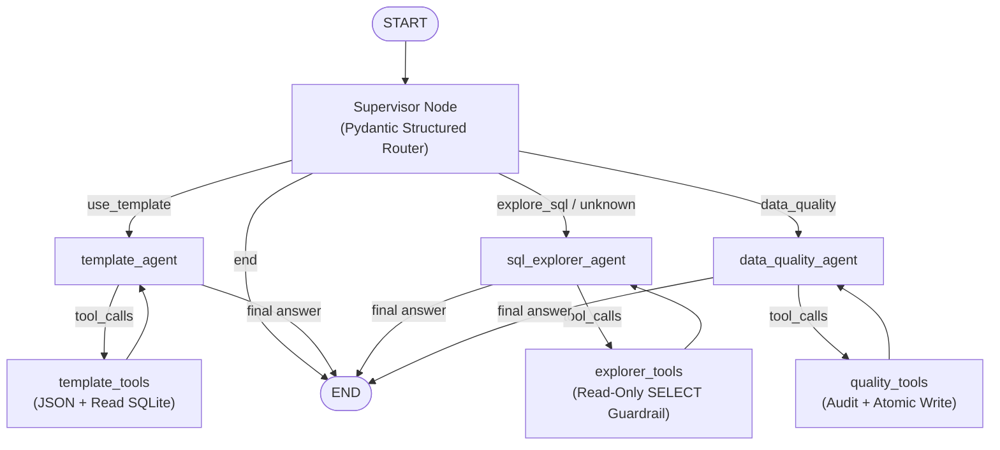

<div align="center">

# Self-Correcting SQL & Data Quality Multi-Agent System

**A LangGraph multi-agent system that converts natural language into safe SQL analytics, detects dirty data in real time, self-corrects query errors, and runs confirmed atomic data-cleaning transactions.**

[](https://www.python.org/)
[](https://langchain-ai.github.io/langgraph/)
[](https://groq.com/)
[](https://www.sqlite.org/)
[](#testing)

</div>

---

## Why This Project?

Traditional analytics workflows break in two opposite ways:

- **Pre-saved BI dashboards** are fast, but cannot answer ad-hoc root-cause questions and silently return wrong totals when dirty data (duplicate webhook retries, negative QA rows, `NULL` amounts) enters the database.
- **Standard Text-to-SQL chatbots** guess schema names, crash on SQLite syntax errors, and miss records when categorical values drift (e.g., `'HDFC'`, `'HDFC Bank'`, and `'hdfc_bank'`).

This system solves both with a **Hybrid Supervisor Architecture**:
1. **Fast Path (`template_agent`):** Runs verified, pre-saved SQL templates for standard business reports.
2. **Ad-Hoc Explorer (`sql_explorer_agent`):** Inspects live schemas & distinct column values, writes dirty-data-aware `SELECT` queries, self-corrects on SQLite errors, and saves reusable templates.
3. **Data Quality Agent (`data_quality_agent`):** Audits tables for anomalies and cleans them inside atomic SQLite transactions after explicit user confirmation.

> **Core Principle:** The LLM handles intent and planning; deterministic Python tools enforce SQL security, schema validation, and database integrity.

---

## Architecture



### Layered Design

| Layer | File(s) | Responsibility |
| :--- | :--- | :--- |
| **Presentation** | `main.py` | CLI REPL, whitelisted token streaming (hides Supervisor JSON), `history.pop()` rollback on errors |
| **Orchestration** | `agent_system/workflows/graph.py` | `StateGraph` wiring, conditional edges, `add_messages` reducer, `recursion_limit=20` |
| **Reasoning** | `agent_system/agents/*.py` | 1 Supervisor + 3 Specialist ReAct agents with pre-bound module-level LLM singletons |
| **Business Logic** | `agent_system/tools/*.py` | Pure Python tools with regex SQL guardrails, schema checks, and ACID cleaning transactions |
| **Data** | `database/` | Indexed SQLite DB (20 merchants, 3,145 UPI transactions) + `saved_queries.json` |

---

## Least-Privilege Tool Access

Each agent has its own isolated `ToolNode` (Defense in Depth). Only `data_quality_agent` can write to SQLite:

| Tool | `template_agent` | `sql_explorer_agent` | `data_quality_agent` | Permission |
| :--- | :---: | :---: | :---: | :--- |
| `list_saved_templates` | ✅ | | | Read (JSON) |
| `run_saved_template` | ✅ | | | Read (SQLite) |
| `list_tables_and_schemas` | | ✅ | ✅ | Read (SQLite) |
| `get_distinct_column_values` | | ✅ | | Read (SQLite) |
| `execute_safe_select_sql` | | ✅ | | Read-Only (`SELECT` / `WITH`) |
| `save_new_query_template` | | ✅ | | Write (JSON Registry) |
| `audit_table_anomalies` | | | ✅ | Read (SQLite) |
| `clean_dirty_records` | | | ✅ | **Write (SQLite ACID Txn)** |

---

## Dataset & Simulated Anomalies

Running `python database/seed_db.py` deterministically (`random.Random(42)`) generates a 100-day FinTech UPI dataset:

- **`merchants` (20 rows):** Across 6 Indian cities and 8 categories.
- **`upi_transactions` (3,145 rows):** Indexed on `(bank_name, txn_status)`, `merchant_id`, and `txn_id`.
- **Injected Dirty Data:**
  - **65 duplicate `txn_id` rows** (simulated webhook retries)
  - **35 negative / zero amount rows** (simulated QA/test accounts)
  - **45 `NULL` amount rows** (simulated malformed payloads)
  - **~8% bank name drift & ~6% status drift** (`'HDFC Bank'`, `'hdfc_bank'`, `'completed'`, `'done'`, `'fail'`)

---

## Quick Start

### 1. Clone & Install

```bash
git clone [https://github.com/Dhananjay810/Self-Correcting-SQL-Agent.git](https://github.com/Dhananjay810/Self-Correcting-SQL-Agent.git)
cd Self-Correcting-SQL-Agent

python -m venv venv
# Windows (PowerShell):
venv\Scripts\activate
# macOS / Linux:
source venv/bin/activate

pip install -r requirements.txt
```

### 2. Configure `.env`

Create a `.env` file in the project root:

```env
GROQ_API_KEY=your_groq_api_key_here
MODEL_NAME=openai/gpt-oss-120b
TEMPERATURE=0.0
```

### 3. Seed Database & Run

```bash
python database/seed_db.py
python main.py
```

---

## Demo Queries to Try

| Step | Prompt | Agent Routed | What Happens |
| :---: | :--- | :--- | :--- |
| 1 | `Show me the merchant revenue summary` | `template_agent` | Runs pre-saved SQL template instantly |
| 2 | `How many HDFC UPI transactions failed and what is their total amount?` | `sql_explorer_agent` | Inspects schema + distinct values, handles `'hdfc_bank'` drift & deduplicates `txn_id` |
| 3 | `Audit upi_transactions for dirty data` | `data_quality_agent` | Reports exact counts + samples for all 4 anomaly types |
| 4 | `Clean all dirty records` | `data_quality_agent` | Asks `yes/no` confirmation, then executes an atomic SQLite cleanup |
| 5 | `Show me the merchant revenue summary` | `template_agent` | Shows clean, deduplicated revenue totals |

---

## Testing

All SQL guardrails, schema validation, anomaly detection, atomic cleaning, and graph routing functions are unit-tested with **zero LLM API calls** using isolated temporary SQLite fixtures:

```bash
pip install pytest
python -m pytest -v
```

<details>
<summary>View Test Coverage (8/8 Passing)</summary>

- `test_list_tables_and_schemas` — Verifies schema discovery
- `test_get_distinct_column_values_valid_and_invalid` — Blocks SQL injection & invalid columns
- `test_execute_safe_select_blocks_write_queries` — Rejects `DELETE`, `DROP`, `UPDATE`, and multi-statement `;` queries
- `test_execute_safe_select_returns_sqlite_error_without_crashing` — Ensures structured error feedback for self-correction
- `test_save_new_query_template` — Saves valid `SELECT` queries and rejects unsafe DDL
- `test_template_list_and_run` — Verifies saved query registry execution
- `test_audit_and_atomic_clean_all` — End-to-end anomaly detection and post-clean verification
- `test_routing_functions` — Verifies supervisor fallback and ReAct loop termination

</details>

---

## Project Structure

<details>
<summary>Click to expand folder tree</summary>

```text
Self-Correcting-SQL-Agent/
├── main.py                              # CLI REPL, whitelist token streaming, error rollback
├── requirements.txt                     # Minimal dependencies
├── .gitignore                           # Ignores .env, *.db, __pycache__, venv
├── database/
│   ├── seed_db.py                       # Deterministic FinTech DB + anomaly generator
│   └── saved_queries.json               # Pre-saved verified SQL templates
├── agent_system/
│   ├── config/settings.py               # Module-level ChatGroq singleton + sanitize_messages()
│   ├── models/state.py                  # AgentState with add_messages reducer
│   ├── tools/
│   │   ├── template_tools.py            # Saved template reader & executor
│   │   ├── sql_tools.py                 # Schema explorer, safe SELECT guardrail, template saver
│   │   └── quality_tools.py             # Anomaly auditor & atomic cleaner
│   ├── agents/
│   │   ├── supervisor.py                # Pydantic structured router
│   │   ├── template_agent.py            # Fast-path specialist
│   │   ├── sql_explorer_agent.py        # Self-correcting SQL specialist
│   │   └── data_quality_agent.py        # Audit & remediation specialist
│   └── workflows/graph.py               # StateGraph wiring & conditional routing
└── tests/
    └── test_tools.py                    # 8 zero-LLM pytest unit tests
```

</details>

---

## Production Roadmap (v2)

- **Graph-Level Human-in-the-Loop:** Add LangGraph `SqliteSaver` / `PostgresSaver` checkpointer + `interrupt_before=["quality_tools"]` for code-enforced confirmation gates and multi-user `thread_id` sessions.
- **Database Isolation:** Connect to a PostgreSQL Read-Replica / Staging DB with role-based permissions.
- **API & Observability:** Expose via FastAPI + WebSocket streaming with JWT auth and LangSmith tracing.
